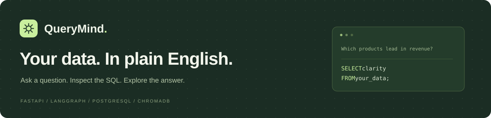
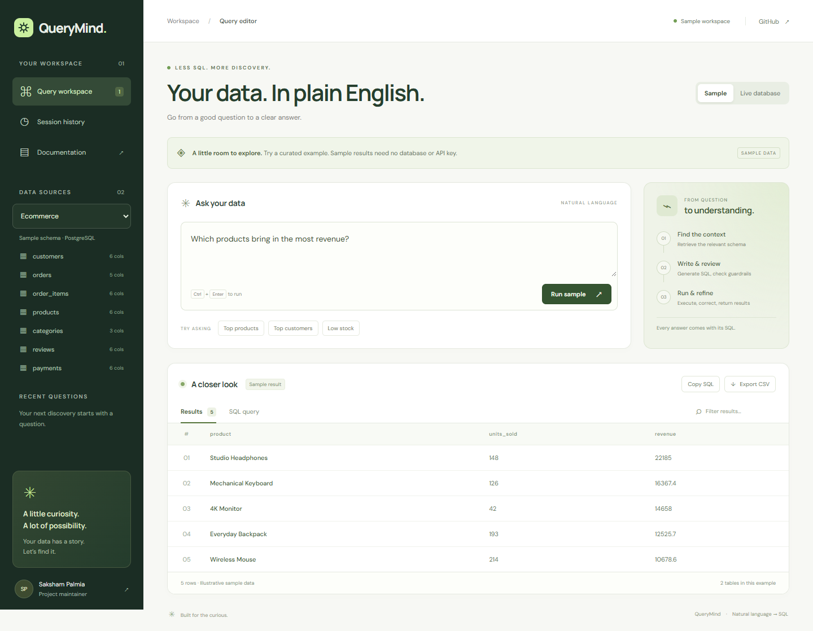
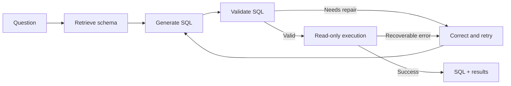

<p align="center">
  
</p>

<p align="center">
  <a href="https://github.com/Saksham-Palmia/querymind/actions/workflows/ci.yml"></a>
  
  
  <a href="LICENSE"></a>
</p>

<p align="center">
  <strong>A natural-language workspace for PostgreSQL.</strong><br>
  Ask a question, inspect the generated SQL, and explore the results in one place.
</p>

<p align="center">
  <a href="#try-the-workspace">Try it locally</a> ·
  <a href="#connect-a-live-database">Connect a database</a> ·
  <a href="docs/ARCHITECTURE.MD">Architecture</a> ·
  <a href="docs/query_pilot_api.md">API reference</a>
</p>



*The screenshot shows sample mode. Its curated rows are illustrative, not live database results.*

## What you can do

- **Explore before configuring anything.** Six sample questions across ecommerce and library data work without a database or API key.
- **Ask your own database.** Live mode calls the FastAPI pipeline with the selected schema and your question.
- **Understand the answer.** Switch between a labeled result table and highlighted SQL, filter rows, copy SQL, or export a CSV.
- **Follow up quickly.** Reuse recent questions during the current session and run queries with Ctrl/Cmd + Enter. History stays in memory and clears on reload.
- **Keep the pipeline transparent.** See attempts, latency, relevant tables, and whether correction was applied.
- **Use it on a smaller screen.** The responsive workspace includes keyboard navigation, explicit loading/error states, and a mobile schema selector.

## Try the workspace

The sample interface uses only Python's standard library. No package installation is needed for this preview.

```bash
git clone https://github.com/Saksham-Palmia/querymind.git
cd querymind
python backend/scripts/preview.py
```

Open **http://127.0.0.1:8080** and try a suggested question. Use `--port 8081` if that port is occupied. The preview server supports sample mode; live mode needs the backend below.

## Connect a live database

Requires Docker with Compose and an OpenAI or Groq API key. The first build downloads the Python dependencies and embedding model.

1. Copy `.env.example` to `.env` (`cp .env.example .env` on macOS/Linux, or `Copy-Item .env.example .env` in PowerShell).
2. Set `OPENAI_API_KEY`, or select `LLM_PROVIDER=groq` and set `GROQ_API_KEY`. The template includes Docker connection settings for the sample PostgreSQL database and Chroma service.
3. Start the stack:

```bash
docker compose up --build
```

Open **http://localhost:8000**, choose **Live database**, and submit a question. The same server provides interactive API documentation at **/docs** and a health endpoint at **/health**. A reachable health endpoint confirms the API is running; it does not prove that every database/model dependency is ready.

On a fresh database volume, Compose creates the ecommerce and library schemas and loads their sample data. Existing volumes keep their data. `.env` is excluded from Git; keep provider keys on the server.

To connect existing tables or run without Docker, follow the [database setup guide](query_mind_use_with_your_own_database.md) and [deployment guide](docs/DEPLOYMENT.md).

## How it works



The schema linker retrieves relevant tables through ChromaDB and sentence-transformer embeddings. A Groq or OpenAI model generates PostgreSQL SQL; the critic checks it before execution. LangGraph manages correction and retries, with **1–5 total attempts** accepted per request (default **3**).

Each compiled graph keeps its own agents, so cached ecommerce and library pipelines cannot overwrite each other's dependencies. Requests within one schema are serialized to protect mutable agent state. The executor explicitly starts a **read-only transaction**, applies a statement timeout, and returns up to 1,000 rows with column names.

## API example

```bash
curl -X POST http://localhost:8000/query \
  -H "Content-Type: application/json" \
  -d '{"question":"Which products have low stock?","schema_name":"ecommerce","max_attempts":3}'
```

Responses include `sql`, `success`, `columns`, `rows`, `row_count`, `attempts`, `latency_ms`, `schema_tables_used`, `correction_applied`, and error information. See the [complete API reference](docs/query_pilot_api.md).

## Stack

| Layer | Tools |
| --- | --- |
| Workspace | HTML, CSS, vanilla JavaScript — served by FastAPI |
| API | FastAPI, Pydantic, Uvicorn |
| Agent workflow | LangGraph, LangChain, OpenAI / Groq |
| Schema retrieval | ChromaDB, sentence-transformers |
| Database | PostgreSQL 16, SQLAlchemy, psycopg2 |
| Development | Docker Compose, pytest, GitHub Actions |

## Verification and evaluation

Run the lightweight regression suite without provider keys, a database, or embedding downloads:

```bash
python -m pip install -r backend/requirements-test.txt
cd backend
python -m pytest tests/unit -q
```

The suite covers request validation, API/static routing, result metadata, retry limits, graph isolation, and read-only execution. Optional [browser checks](backend/scripts/check_ui.py) use the `playwright` Python package and an **already installed** Chrome or Edge executable; the script does not download a browser.

Historical evaluation artifacts are kept in [backend/evaluation_results](backend/evaluation_results) and [the evaluation report](docs/EVALUATION_REPORT.md). The recorded core ecommerce run reports **67/70 execution successes**. These are historical results, not a fresh benchmark of this edition, and execution success does not establish that an answer is semantically correct.

## Scope and limitations

QueryMind is a development and portfolio project. SQL validation uses heuristics; generated queries and results should be reviewed. For a public live deployment, add authentication and rate limits, and use a restricted read-only database account. The bundled local stack binds to localhost and has no application login. Model calls can incur provider charges.

Sample mode uses fixed fixtures and supports its suggested questions only. The browser timeout stops waiting after two minutes; it does not cancel work already running on the server. Export includes all returned rows, even if the visible table is filtered. Google Fonts are optional; system fonts provide a fallback.

## Explore the source

```text
backend/app/web/       Responsive query workspace
backend/app/api/       Request and response endpoints
backend/app/agents/    Schema linking, SQL, validation, execution, correction
backend/app/schema/    Metadata extraction and vector storage
backend/tests/unit/    Tests that run without external services
backend/scripts/      Preview, indexing, evaluation, and browser checks
database/             Sample PostgreSQL schemas and seed data
docs/                 Architecture, deployment, and historical reports
```

## Author and license

Maintained by **[Saksham Palmia](https://github.com/Saksham-Palmia)**. Released under the [MIT License](LICENSE). Copyright © 2026 Saksham Palmia.
